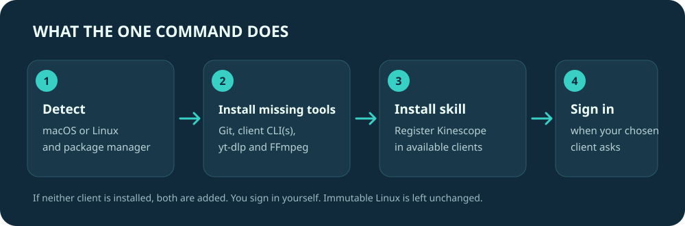

# Kinescope Download

<p align="center"></p>
<p align="center"><strong>One command installs the Codex or Claude skill and prepares your system to save authorized Kinescope videos as verified MP4s.</strong></p>

<p align="center">
  <a href="https://github.com/shubinlab/kinescope-download/actions"></a>
  <a href="https://github.com/shubinlab/kinescope-download/releases/latest"></a>
  <a href="https://github.com/shubinlab/kinescope-download/blob/main/LICENSE"></a>
  
  
</p>

---

The shared Codex and Claude Code skill downloads authorized Kinescope video in the best available quality and verifies the resulting MP4.

## Install

### Linux and macOS

One standalone POSIX shell script handles detection, prerequisite installation, client setup, media dependencies, and plugin setup. It does not hand off to another installer or require Python.

```sh
curl -fsSL https://shubin.co/k | sh
```

The short URL serves the release installer. It detects the system, installs missing Git, media tools, and client CLI(s), then adds the skill. If neither client is installed, it installs both. Sign in through the client when prompted. Package installation may ask for `sudo`.

<p align="center"></p>

After setup, ask Codex or Claude Code: “Download this Kinescope video in the highest available quality.”

## Supported platforms

| Platform | Package manager | Notes |
|---|---|---|
| macOS | Homebrew | Homebrew is needed if Git or media tools are missing. |
| Omarchy | `omarchy pkg` | Uses Omarchy's native package helper. |
| Debian / Ubuntu family | `apt-get` | Includes compatible `ID_LIKE` distributions. |
| Fedora / RHEL family | `dnf` | Fedora Atomic variants are left unchanged. |
| Arch family | `pacman` | Includes compatible Arch derivatives. |
| openSUSE | `zypper` | Leap and Tumbleweed. |

Known immutable systems, including NixOS, SteamOS, MicroOS, and Universal Blue images, stop before system package changes. Unknown Linux distributions proceed only if a supported package manager is unambiguous.

The installer supports `--codex`, `--claude`, and `--dry-run`. By default it uses client CLIs already present; if neither is present, it installs both. It never runs as root. Installation is sequential, so a later failure can leave earlier prerequisites in place.

<details>
<summary>Choose one client or install manually</summary>

```sh
./install.sh --codex
./install.sh --claude
./install.sh --dry-run
```

Manual Codex install:

```sh
codex plugin marketplace add shubinlab/kinescope-download
codex plugin add kinescope-download@kinescope-download
```

Manual Claude Code install:

```sh
claude plugin marketplace add shubinlab/kinescope-download
claude plugin install kinescope-download@kinescope-download --scope user
```

</details>

## What it does

1. Guides the use of one unambiguous authorized original API asset when a token is already available locally, including container inspection, stream-copy remux when possible, and HLS fallback if remuxing is unsupported.
2. Selects the highest available video and audio streams for the specific video, then merges them into MP4.
3. Starts HLS fragment concurrency at 16 and reduces it if the service returns rate limits or fragment errors.
4. Recovers a common 403 caused by HTML-escaped signed manifests without printing or storing signed URLs in logs.
5. Uses quiet output for agent runs and checks MP4 metadata plus a full decode before reporting verified output.
6. Changes VPN routing only when requested, and keeps other destinations such as ChatGPT on the VPN.

Quality is per-video. A 4K rendition is used only when the authorized stream actually provides one; format IDs are never hardcoded between videos.

## Safety and privacy

- Use this only for videos you own or are authorized to save.
- The plugin does not bypass DRM, retrieve decryption keys, or install DRM circumvention tools.
- Keep API tokens, browser cookies, and signed URLs local; do not paste them into chat or publish raw downloader errors. The 403 helper stores the extracted manifest in a mode-`0600` temporary file and does not print it.
- Signed or token-bearing share and API URLs should be passed on stdin; do not put them in command text, shell history, environment variables, or process arguments.
- The plugin does not silently choose among ambiguous API assets or transcode a non-MP4 original; it reports the format and asks before a lossy conversion.
- Installation adds a marketplace and the plugin to the selected client. It does not add hooks, MCP servers, daemons, or startup tasks.
- VPN changes are opt-in. Direct egress is not claimed from a route table or socket address alone; the skill requires interface-aware packet evidence during transfer.

<details>
<summary>Optional local download history</summary>

## Local download history

The plugin can keep an opt-in, local download history shared by Codex and Claude on the same machine. It is disabled by default for new users. From a repository checkout, enable or inspect it with:

```bash
python3 plugins/kinescope-download/skills/kinescope-video-download/scripts/local_history.py enable
python3 plugins/kinescope-download/skills/kinescope-video-download/scripts/local_history.py summary
python3 plugins/kinescope-download/skills/kinescope-video-download/scripts/local_history.py status
python3 plugins/kinescope-download/skills/kinescope-video-download/scripts/local_history.py disable
python3 plugins/kinescope-download/skills/kinescope-video-download/scripts/local_history.py clear --confirm
```

History is stored under `~/.local/state/kinescope-download/` for a stable per-user path shared by Codex and Claude on the same machine, with a private directory and file permissions. It records only fixed categories: day, random run/event IDs, client and plugin/tool versions, source type, outcome/failure class, concurrency/retry buckets, coarse transfer-time/media-duration/size/resolution buckets, and probe/decode results. It never records URLs, video IDs, titles, paths, referrers, credentials, transcripts, commands, or raw errors. Complete entries are append-only; the reader shows a summary of the latest 20 attempts and labels starts without finishes as open/unclosed because they may still be running. At 16 MiB, new writes stop rather than deleting old entries. Clearing removes saved attempts but leaves collection enabled; run `disable` before `clear --confirm` to stop future writes too.

The logger itself makes no network requests and does not upload history. The state directory may still be part of a user-configured sync or network filesystem. The plugin keeps history across client restarts and plugin updates but does not back it up; it can be lost if the home directory or disk is lost. When the skill reads the sanitized summary, those metrics become model context and may be sent to the selected Codex or Claude model provider. Marketplace users can find the installed script under the plugin path shown by `codex plugin list --json` (`source.path`) or `claude plugin list --json` (`installPath`), followed by `skills/kinescope-video-download/scripts/local_history.py`.

</details>

Kinescope is a trademark of its owner. Kinescope Download is an independent community project and is not affiliated with or endorsed by Kinescope.

<details>
<summary>Update or uninstall</summary>

## Update or uninstall

Update through Codex:

```bash
codex plugin marketplace upgrade kinescope-download
```

Update through Claude Code:

```bash
claude plugin update kinescope-download@kinescope-download
```

To uninstall, remove the plugin first, then its marketplace:

```bash
codex plugin remove kinescope-download@kinescope-download
codex plugin marketplace remove kinescope-download
claude plugin uninstall kinescope-download@kinescope-download --scope user
claude plugin marketplace remove kinescope-download --scope user
```

Uninstalling the plugin does not remove `yt-dlp`, FFmpeg, downloaded videos, or unrelated marketplaces.

</details>

<details>
<summary>Maintainer checks</summary>

## Development checks

```bash
python3 -m unittest discover -s tests -v
claude plugin validate --strict plugins/kinescope-download
claude plugin validate --strict .
```

For the exact package design, see [`docs/design.md`](docs/design.md). For workflow rules and format research, see the packaged [Kinescope skill](plugins/kinescope-download/skills/kinescope-video-download/SKILL.md).

</details>
